#  Hirely

### AI-Assisted Recruitment & Adaptive Interview Platform

Hirely is an end-to-end recruitment platform that connects **job discovery, applications, resume screening, adaptive interviews, and expert evaluation** in a unified workflow.

The platform is designed to support both sides of the recruitment process: **candidates looking for opportunities** and **experts managing and evaluating candidates**.

---
## Acknowledgement 

It was a group project for hackathon.This repository is maintained by me.

## My Contributions

Hirely was developed collaboratively as a hackathon project. My primary contributions focused on the main user interface, candidate and recruiter workflows, and the AI-powered interview experience.

- **Main UI Development**: Worked on building the main user interface, focusing on the layout, visual presentation, navigation, and interactive user experience.
  
- **Candidate Portal**: Contributed to the candidate-facing interface and workflows, enabling candidates to interact with the platform and access its recruitment and interview features.
  
- **Recruiter Portal**: Worked on the recruiter-facing interface and workflows, supporting recruiter interactions with the platform.
  
- **AI-Powered Interview System:** Worked on the core AI interview functionality, including the interview interaction flow and sound-enabled features to make the interview experience more interactive.
  
- **Voice-Based Interaction:** Contributed to sound-related interview functionality using browser APIs, including the Web Speech API and MediaRecorder API.
  
- **Frontend Integration:** Worked with HTML, CSS, and JavaScript to connect interface components with application functionality and maintain a consistent experience across candidate and recruiter views.
  
- **Collaborative Development:** Collaborated with teammates to integrate and refine the platform's features during the hackathon.

Team contribution: ATS functionality was primarily handled by another team member, while my focus was on the UI, candidate and recruiter experiences, and the AI interview system.

##  Key Features

### Candidate

- Browse and search open positions
- Apply for job opportunities
- Upload resumes
- AI-assisted resume screening
- Job-resume matching
- View Application Status
- View scheduled interviews
- Participate in online interviews
- Answer interview questions through text or voice

### Expert / Recruiter

- Manage open positions
- Review candidate applications
- Review and modify interview questions
- Participate in live interviews
- Evaluate candidate responses
- Make recruitment decisions

### AI-Assisted Capabilities

- Resume parsing and text extraction
- Job-resume matching
- Candidate screening
- Adaptive interview question generation
- Interview response analysis
- AI-assisted candidate evaluation

---

##  Recruitment Workflow

### Candidate Journey

**Find Jobs → View Position → Apply → Resume Screening → Track Application → Interview → Evaluation**

### Expert Journey

**Create Position → Review Applications → AI-Assisted Screening → Shortlist → Schedule Interview → Evaluate Candidate → Final Decision**

---

##  Technology Stack

| Layer | Technologies |
|---|---|
| **Frontend** | HTML, CSS, JavaScript |
| **Backend** | Python,FastAPI|
| **Data Storage** |Browser Local Storage |
| **AI / Processing** | NLP, Resume Parsing with PyMuPDF, AI-Assisted Screening,Speech Recognition with PocketSphinx |
| **Browser APIs** | Storage Event API,Web Storage API,Web Speech API, MediaRecorder API |
| **Version Control** | Git, GitHub |

---

##  Project Screenshots

###  Home

**The Hirely homepage where candidates can browse available open positions and explore job opportunities.**

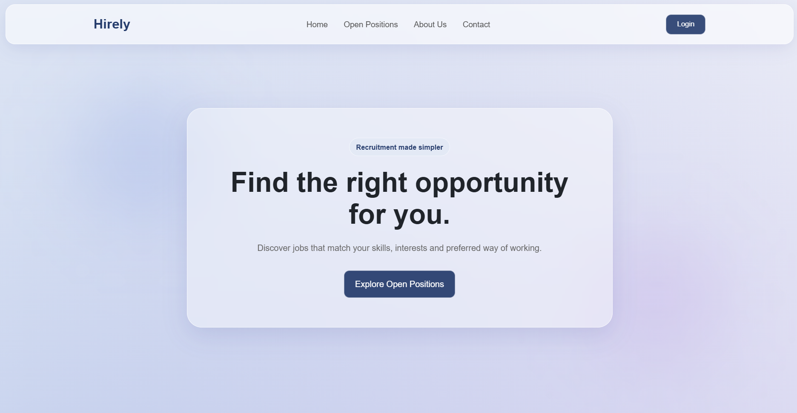

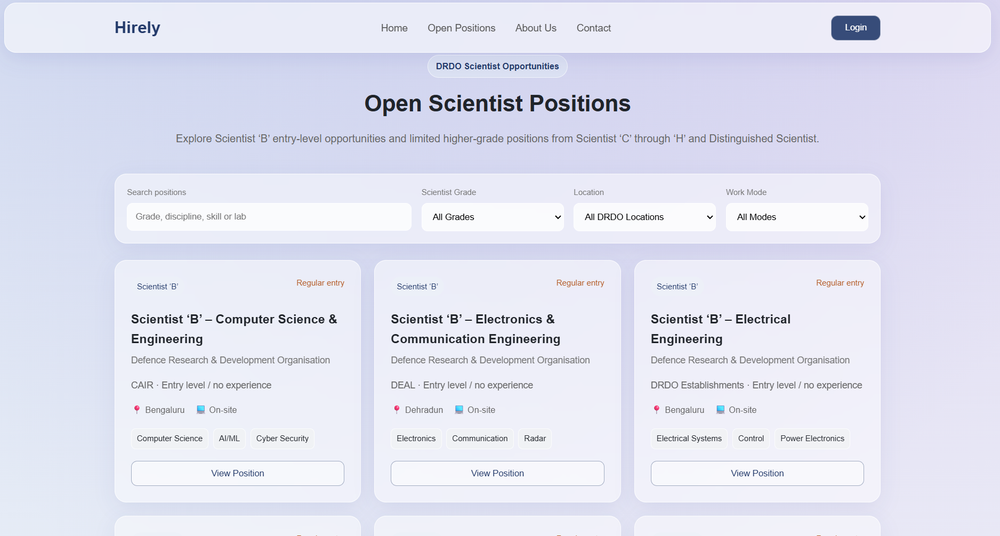

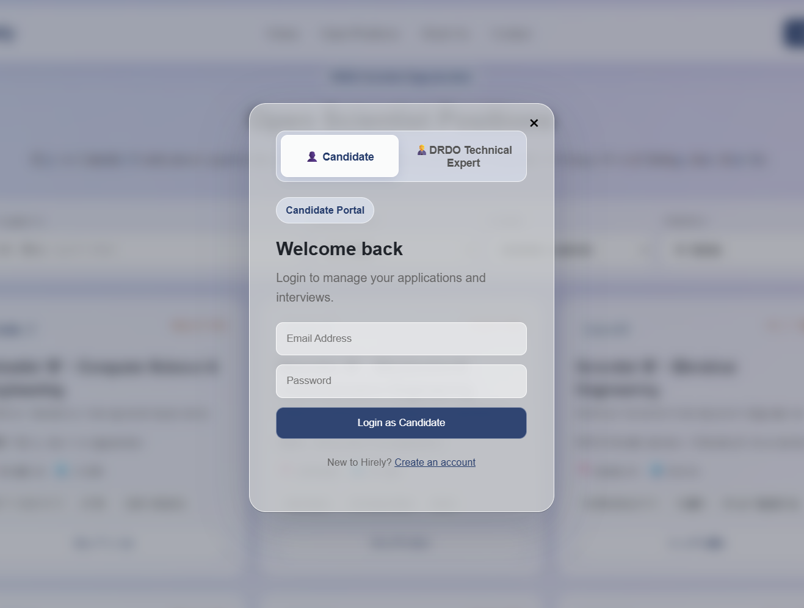

---

###  Candidate Portal

**The candidate portal where candidates can find jobs, view job details, apply for positions, complete resume screening, track applications, and proceed through the interview process.**

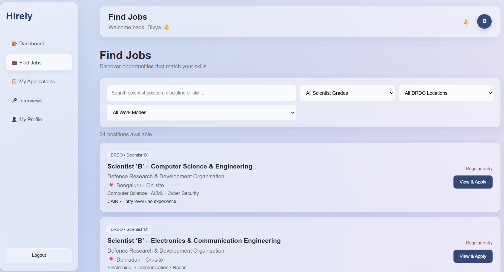

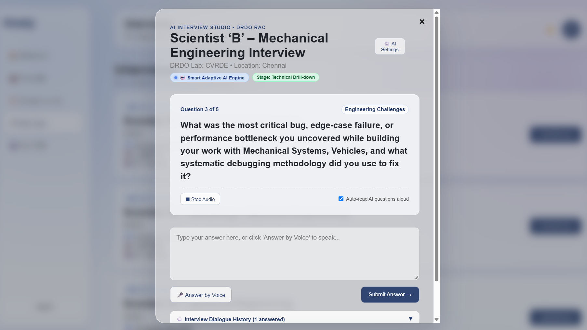

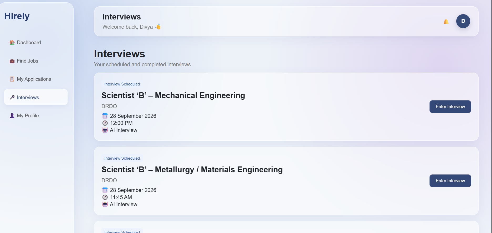

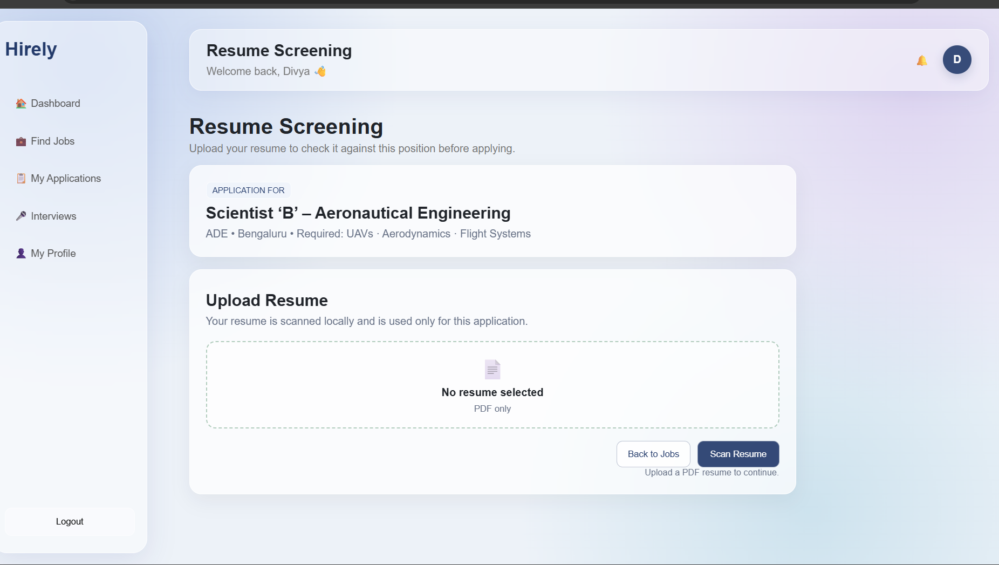

---

###  Expert Portal

**The expert portal where recruiters can review applications, evaluate AI-screened candidates, shortlist candidates, conduct interviews, and make recruitment decisions.**

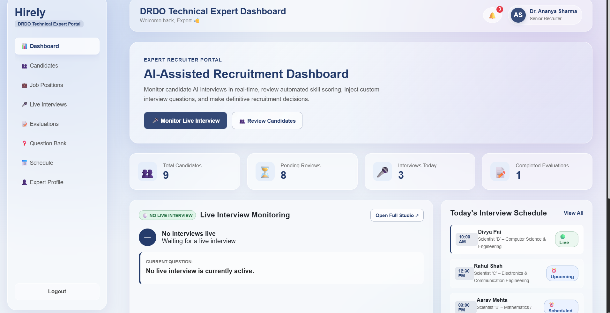

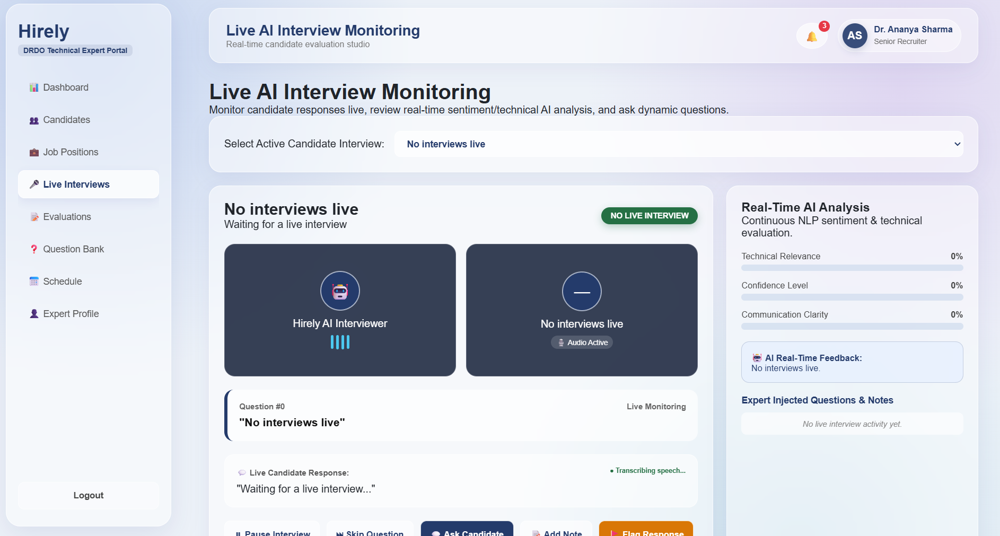

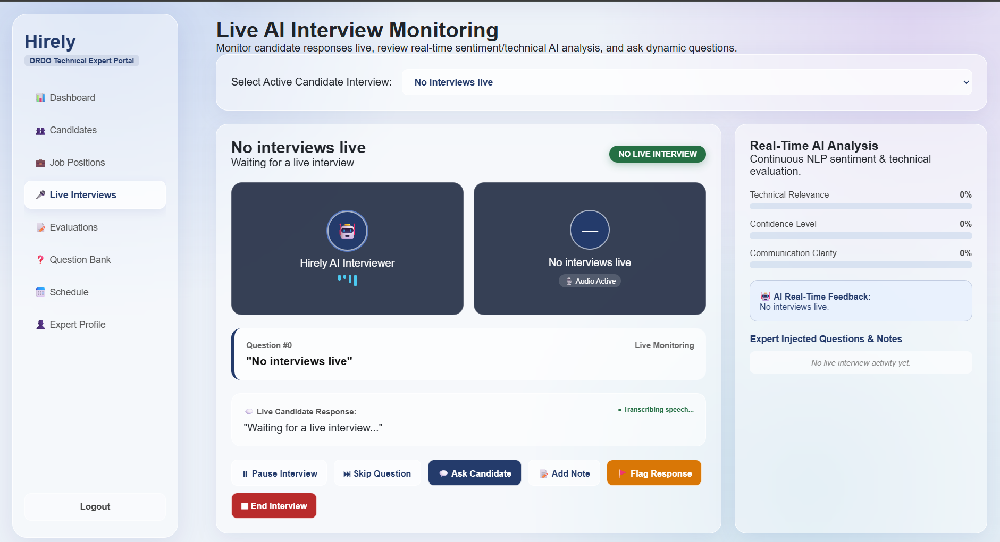

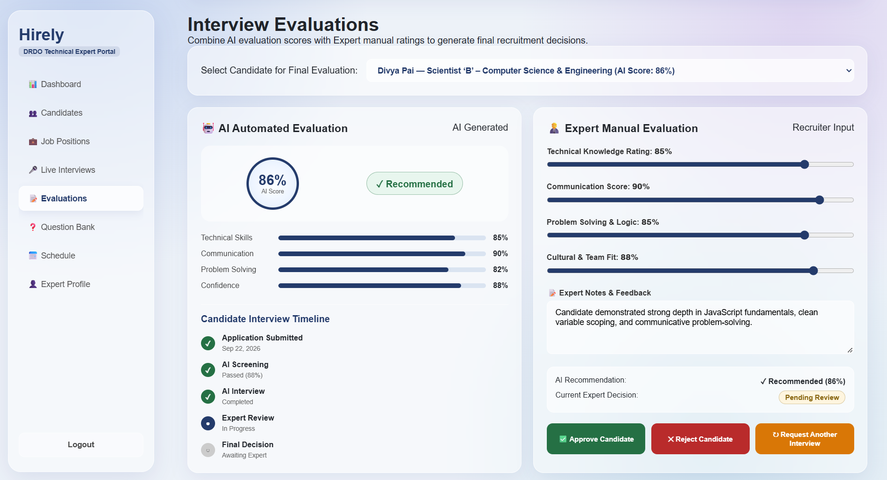

---

##  System Overview

Hirely is organized around three connected layers:

### 1. Candidate Portal

Provides candidates with a complete recruitment journey, from discovering job opportunities to applying, completing resume screening, tracking applications, and participating in interviews.

### 2. AI-Assisted Recruitment Layer

Processes resumes and job requirements to support candidate screening, job-resume matching, adaptive interview question generation, and interview evaluation.

### 3. Expert Portal

Provides recruiters with tools to manage positions, review applications, evaluate candidates, shortlist applicants, schedule interviews, and participate in the final evaluation process.

---

##  Project Objective

Hirely aims to simplify and connect the major stages of recruitment through a single platform while using AI-assisted features to support **candidate screening and adaptive interviewing**.

The platform focuses on creating a structured workflow for both candidates and recruitment experts.

---

##  Future Scope

- Migration to a database such as PostgreSQL
- Integration of Gemini API for advanced AI capabilities
- Semantic-based resume and job matching
- Advanced recruitment analytics
- Automated candidate notifications
- Enhanced speech-based interviews
- Cloud deployment
- Advanced candidate insights
- Expanded authentication and security

